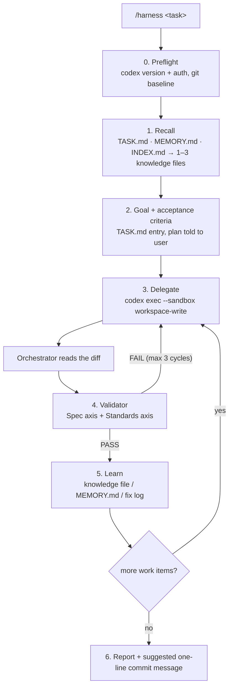

# claude-codex-harness

A [Claude Code](https://docs.claude.com/en/docs/claude-code) skill that runs engineering tasks through a fixed loop. **Claude plans, [Codex CLI](https://github.com/openai/codex) writes the code, and a separate read-only Validator agent checks it.** Each step is recorded in files, so an interrupted task can pick up where it stopped, and what the loop learns is written back into a small knowledge base about your project.

```
/harness add a ?status filter to GET /orders, default unchanged
```

## Why

Letting one agent plan, implement and grade its own work in a single context goes wrong in familiar ways: it forgets project rules halfway through, says "done" without running the tests, adds code nobody asked for, and makes the same mistake again next week. The harness splits the work into roles and makes each role leave a written record:

| Role | Who | What it does | What it never does |
|---|---|---|---|
| Orchestrator | Claude (the session you're in) | loads the relevant knowledge, writes the goal and acceptance criteria, delegates, reads the diff, records progress and learnings | write the implementation itself |
| Worker | Codex CLI (`codex exec`, sandboxed) | implements one work item in one repo | commit, push, or edit outside the repo |
| Gate | `Validator` subagent (read-only) | checks the diff against the goal, the project invariants and the code standard; runs the checks | edit code |

Each task also leaves three kinds of record:

- **`TASK.md`**: the plan and status of every task, updated at every step. If the session dies, the next `/harness` call resumes it.
- **`knowledge/`**: one short file per feature area, holding facts, *invariants* (rules a change must keep), gotchas and how to verify. The loop loads only the 1–3 files a task needs, never the whole folder.
- **`MEMORY.md`**: what the loop learned about itself (Codex quirks, prompts that worked, tooling traps).

## How the loop works



1. **Preflight.** Checks that `codex` is installed, current and logged in, and records which files were already dirty in each repo, so Codex's changes can be told apart from yours.
2. **Recall.** Resumes a matching task from `TASK.md` if there is one. Reads `MEMORY.md`, then routes the task through `knowledge/INDEX.md` and opens only the files whose *Load when* column matches. `code-quality.md` is always loaded.
3. **Goal and plan.** Restates the task as checkable acceptance criteria, splits it into 1–3 work items (one repo each), writes the `TASK.md` entry and tells you the plan in a few sentences.
4. **Delegate.** Runs `codex exec --cd <repo> --sandbox workspace-write` with the goal, the criteria, the *paths* of the knowledge files to read, the invariants that apply, and a fixed instruction to follow `code-quality.md` and make no git writes. Output goes to a log so you can follow it with `tail -F`.
5. **Validate.** The orchestrator reads the diff itself, then the `Validator` agent independently checks two separate axes: **Spec** (goal, criteria, invariants, every caller of changed functions) and **Standards** (`code-quality.md`'s slop list and smells). Keeping them apart stops a correct feature from hiding sloppy code, or clean code from hiding a missed requirement. On FAIL, the numbered findings go back to Codex verbatim. After three failed cycles the orchestrator either fixes the small leftovers itself or marks the task `blocked` and asks you.
6. **Learn.** Writes down only what isn't obvious from the diff: a fact that proved a knowledge file wrong (fixed in place, with its *Verified* date bumped), a new feature area (new file plus an index row), or a loop learning (`MEMORY.md`).
7. **Report.** Lists the files changed, the Validator verdict, which checks ran and which couldn't, what was learned, and a suggested one-line commit message. **The harness never commits.** Changes stay unstaged for you to review.

## Requirements

- [Claude Code](https://docs.claude.com/en/docs/claude-code)
- [Codex CLI](https://github.com/openai/codex) on your `PATH`, logged in: `npm i -g @openai/codex && codex login`
- git, plus whatever your repos need to lint and test

## Install

Copy the skill and the agent into a project (recommended: the task tracker and knowledge base are about *that* project):

```bash
git clone https://github.com/<you>/claude-codex-harness.git
cd your-project
mkdir -p .claude/skills .claude/agents
cp -r ../claude-codex-harness/.claude/skills/harness .claude/skills/
cp ../claude-codex-harness/.claude/agents/Validator.md .claude/agents/
```

Or install it for all your projects by copying to `~/.claude/skills/harness` and `~/.claude/agents/Validator.md` instead. In that case one knowledge base covers everything you work on, so a per-project install is usually the better fit.

Let Claude run Codex without asking each time by adding this to `.claude/settings.json`:

```json
{
  "permissions": {
    "allow": ["Bash(codex exec:*)"]
  }
}
```

The rule matches the literal command prefix, which is why the skill always starts the command with bare `codex exec` (no `cd … &&` or `VAR=…` in front).

## Set up your knowledge base

The harness ships with a ready code standard and empty templates. It works with nothing filled in, but the knowledge base is where most of its value comes from.

| File | Ships as | You do |
|---|---|---|
| `knowledge/code-quality.md` | ready to use | optional: tighten it for your stack. Repo rules (`AGENTS.md`, `CLAUDE.md`, linters) always override it |
| `knowledge/INDEX.md` | template (`TODO`s) | write the project prompt, scope rules and quality gates; add one routing row per feature file |
| `knowledge/00-system-map.md` | template | which component owns what, the data flow, environments |
| `knowledge/local-env-and-testing.md` | template | containers, ports, **exact test commands**, and *safety preconditions* the Validator must check before running tests |
| `knowledge/_TEMPLATE.md` | template | copy it for each feature area |

Fastest start: in Claude Code, ask *"read this repo and fill in `.claude/skills/harness/knowledge/00-system-map.md` and `local-env-and-testing.md`"*, then check the result. Wrong knowledge is worse than none.

Each feature file uses the same sections:

- **Load when**: the words a task would use (feature names, classes, endpoints, error messages). This is what routing matches on.
- **Verified**: the date and commit the file was last checked against. The code always wins over the file.
- **Facts**: a short map of how it works, with file paths.
- **Invariants**: numbered rules a change must keep. Codex gets them in its prompt; the Validator reports each one as *held / broken / not touched*.
- **Gotchas**, **Verify**, **Sources**.

See [`examples/knowledge/background-jobs.md`](examples/knowledge/background-jobs.md) for a filled-in example.

Keep each file under ~60 lines. Each one is a dated map of where to look, not a copy of the code.

## Use

```text
/harness <task description>
```

Examples:

```text
/harness fix: exporting an empty report returns 500 instead of an empty CSV
/harness add rate limiting to POST /login (5/min per IP), behind the existing feature-flag helper
/harness resume T-004
```

A typical run ends with a report like:

```
T-004 — Empty report export 500  ·  done
Files: src/reports/export.ts, tests/reports/export.test.ts
Validator: PASS (spec 0 · standards 1 WARN: long function in export.ts:40)
Checks: tsc --noEmit ok · vitest tests/reports 12 pass (1 failed before the change)
Learned: knowledge/reports.md invariant #3 added (exports stream, never buffer)
Commit: fix(reports): return empty CSV for reports with no rows
```

## The rules it enforces

- **No git writes.** Neither Codex nor Claude commits, stages, stashes, resets or pushes without your explicit approval. If Codex stages something, the orchestrator unstages it.
- **Sandboxed worker.** Codex runs with `--sandbox workspace-write`: writes only inside the target repo, no network. The bypass flag is used only when a work item truly needs network or docker, and the report says so.
- **Evidence over claims.** The Validator must list every check it ran. "Passed" for a check that never ran is not allowed, and a partial run is never reported as the whole suite passing.
- **Tests for behaviour.** New behaviour or a bug fix comes with a test that fails before the change. Renames, config and docs don't need one.
- **No AI slop.** `code-quality.md` §3 lists ten patterns that are automatic BLOCKERs: scope creep, comments that restate code, catches that swallow errors, needless abstractions, compatibility shims, weakened tests, debug leftovers, hard-coded secrets, duplicated rules.
- **Precedence is explicit.** Your instruction > your standing rules > repo rules > harness and knowledge > other installed skills. When two sources still disagree, the harness asks you once and records the answer in `SKILL.md`.

## Customise

- **Model and effort.** Codex uses the model in your Codex `config.toml`; the harness sets `model_reasoning_effort=medium` and goes up to `high` only for a work item that failed validation twice. Edit section 3 of `SKILL.md` to change either.
- **Validator model.** Set by `model: opus` in `.claude/agents/Validator.md`. Change it to any model your Claude Code supports.
- **Cycle limit.** 3 delegate→validate cycles, set in section 4 of `SKILL.md`.
- **Another worker.** The loop doesn't depend on Codex specifically. Any CLI agent that takes a prompt, works in one directory and can be sandboxed fits. Replace the command in section 3 and the preflight checks.

### Optional: a separate `CODEX_HOME`

If an IDE extension also uses `~/.codex`, it can lock Codex's state database and make `codex exec` hang. Give the harness its own home with a small wrapper earlier on your `PATH`:

```bash
#!/usr/bin/env bash
# ~/.local/bin/codex
export CODEX_HOME="$HOME/.codex-harness"
exec /path/to/real/codex "$@"
```

Copy `~/.codex/config.toml` and `~/.codex/auth.json` into `~/.codex-harness/`. Re-copy `auth.json` when the harness copy starts returning 401 ("refresh token was already used"), which happens after the main login rotates its tokens.

## Troubleshooting

| Symptom | Likely cause | Fix |
|---|---|---|
| `codex exec` asks for permission every time | something precedes `codex exec` in the command | the command must start with `codex exec`; check the allow rule |
| Configured model missing / falls back | old Codex client, older model catalog | `npm i -g @openai/codex@latest` |
| `AUTH_OK` probe fails with 401 | expired or rotated token | `codex login` (or re-copy `auth.json` with a separate `CODEX_HOME`) |
| Codex hangs at start in workspace-write | sandbox issue on older kernels / WSL, or a locked state DB | update Codex; try a separate `CODEX_HOME` |
| No output until Codex finishes | output piped into `tail` | the skill tees to a log; `tail -F` the log path from the report |
| Validator keeps failing on the same finding | the finding contradicts a repo rule or the knowledge | after 3 cycles the loop stops and asks you; fix the knowledge file or the rule |

## Layout

```
LICENSE                          MIT
.claude/
  agents/
    Validator.md                 read-only gate (Spec + Standards axes)
  skills/harness/
    SKILL.md                     the loop: what the orchestrator does at each step
    TASK.md                      task tracker (resumable)
    MEMORY.md                    loop-level learnings (ships with generic seed bullets)
    knowledge/
      INDEX.md                   project prompt + routing table   (template)
      code-quality.md            code standard, always loaded     (ready)
      00-system-map.md           ownership + data flow            (template)
      local-env-and-testing.md   commands + safety preconditions  (template)
      _TEMPLATE.md               shape of a feature file
examples/
  knowledge/background-jobs.md   a filled-in feature file
```

## Credits

`code-quality.md` adapts ideas from public agent-skill collections: mattpocock/skills (`code-review`, `codebase-design`), addyosmani/agent-skills (`code-simplification`), rohitg00/pro-workflow (`deslop`), and oh-my-claudecode (`ai-slop-cleaner`).

## License

[MIT](LICENSE)
